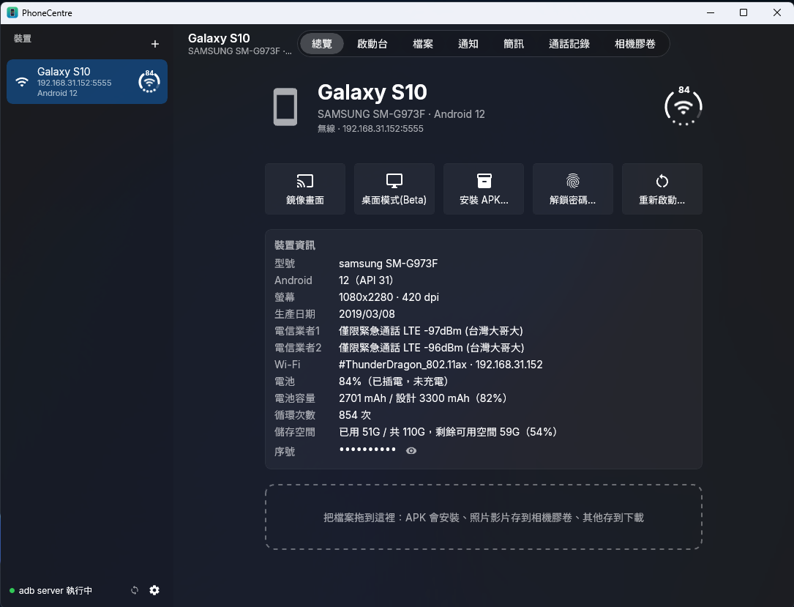
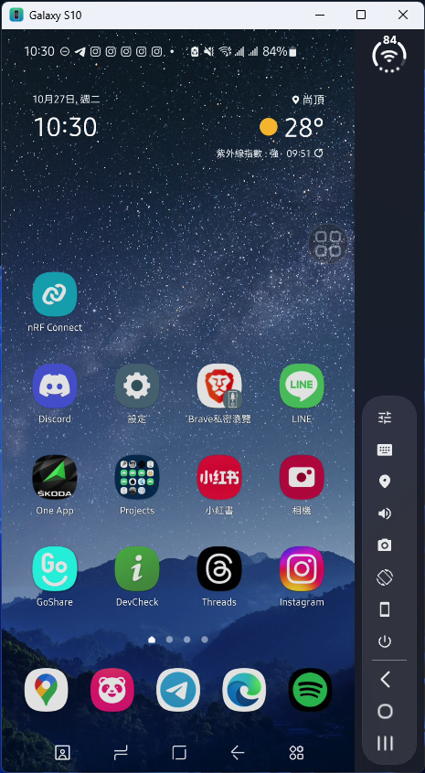
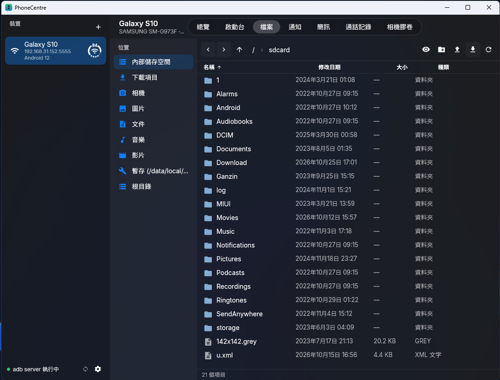
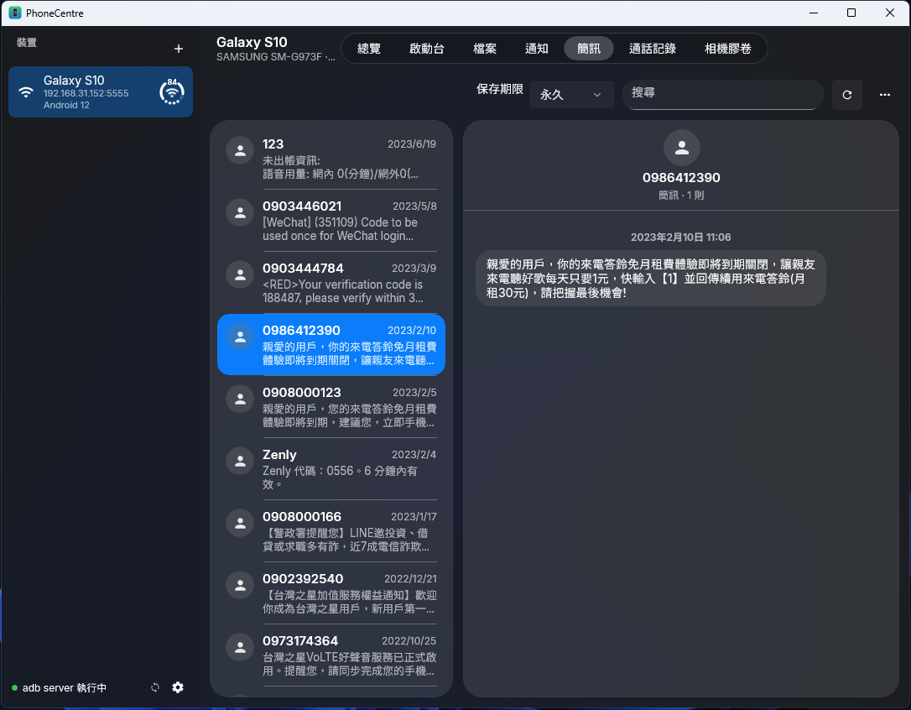

# PhoneCentreOnPC (Beta)

### PC版目前是測試階段，可能有很多bug ><
### 如果你有Mac，推薦優先使用Mac版 [PhoneCentre](../PhoneCentre)

在 Windows PC 上管理 Android 手機的原生 App（WinUI 3、C#／.NET 10），是 [PhoneCentre](https://github.com/iambjlu/PhoneCentre)（macOS 版）的 Windows 版。
透過 adb 連接手機，用 scrcpy-server 鏡像畫面與遠端操作；另外提供 App 啟動台、檔案管理、相機膠卷、
通知／簡訊／通話記錄，以及讓手機上的 App 以 PC 獨立視窗執行。

成品是**單一 exe**：雙擊就能用，免安裝（內含 .NET 執行階段、Windows App SDK、精簡 FFmpeg、scrcpy-server）。

> 這是作者自用的專案，**不保證任何功能在你的手機上可用**，使用前請先閱讀最下方的[免責聲明](#免責聲明)。



## 特色

### 總覽
- 側邊欄列出所有 USB 與無線連線的手機，每台都有電池／網路狀態環
- 裝置資訊：型號、Android 版本、螢幕解析度與 dpi、生產日期、電信業者（雙卡分開列出，含訊號強度）、Wi-Fi、電池狀態、電池容量與設計容量（健康度）、循環次數、儲存空間；序號預設遮蔽，點眼睛圖示才顯示
- 喜好項目與已開啟的 App 一眼看到，點一下就開啟
- 一鍵鏡像畫面、桌面模式 (Beta)、安裝 APK、解鎖密碼、重新啟動手機
- 把檔案拖進來：APK 會安裝、照片影片存到相機膠卷、其他存到下載
- 左下角顯示 adb server 狀態，可一鍵重新啟動

### 鏡像畫面與獨立 App 視窗

- 低延遲的手機畫面鏡像（FFmpeg 軟體解碼 H.264），滑鼠與鍵盤都能操作，支援輸入法打中文
- 手機的聲音可以傳到 PC 播放
- 手機上的 App 可以在**虛擬顯示器**上執行，PC 端變成一個獨立視窗，也可以選擇讓工作列每個視窗各自顯示一個圖示
- 右側欄有狀態環（電量、Wi-Fi）與工具列（畫質、輸入法、模擬定位、聲音、截圖、旋轉、黑屏、電源），底部是返回、主畫面、最近使用的 App 三個導覽鍵（沿用三星 One UI 風格）
- 模擬定位：在地圖上點一下，手機就使用那個位置
- 偵測到手機在鎖定畫面時，可以用 Windows Hello 驗證後自動填入手機密碼



### 啟動台
- 類似 Mac 版啟動台：喜好項目、已開啟、所有 App（依英文字母與注音分組，右側索引快速捲動）
- 可以選擇在獨立視窗或手機主螢幕開啟；右鍵可強制停止、解除安裝、查看 App 資訊

### 檔案

- 檔案總管風格的手機檔案管理：左側快速位置（內部儲存空間、下載項目、相機、圖片、文件、音樂、影片、暫存、根目錄）
- 路徑列與上一頁／下一頁／上層資料夾導覽；依名稱、修改日期、大小、種類排序
- 重新命名、刪除、新增資料夾，工具列可上傳到手機、下載到 PC
- 拖進來上傳、拖到檔案總管下載



### 相機膠卷
- 格狀檢視；「所有照片」一次看完 DCIM 底下所有資料夾，可以只看照片或只看影片
- Ctrl 點選多選、Shift 點選範圍選取、Ctrl＋A 全選，一次匯出到 PC
- 縮圖在手機端產生，只傳小圖，捲動很順；雙擊以內建檢視器看原圖或播放影片

### 通知、簡訊、通話記錄

- 只透過 adb 讀取，**不在手機上安裝任何 App**
- 預設關閉（因為是個人隱私資料），需要時在頁面上開啟
- 資料只保存在這台 PC，可分別設定保存期限（例如「永久」）、搜尋或隨時刪除
- 簡訊依號碼分組成對話；通知會記錄已清除的項目，點一下就可以打開對應的 App



### 系統匣
- 系統匣圖示叫出小視窗：每台已連線裝置的鏡像按鈕與最近使用的 App
- 關閉主視窗時程式會留在系統匣，鏡像視窗不受影響

## 系統需求與建置

- Windows 10 1809 以上（x64，ARM64 也支援）
- 手機需開啟「開發人員選項 → USB 偵錯」（無線連線需要「無線偵錯」或先用 USB 轉成無線）
- 找不到 adb 時，App 會在你同意後從 Google 官方網站下載 Android SDK Platform-Tools
- adb.exe 第一次執行時 Windows 防火牆會詢問，請按「允許」
- 模擬定位需要 WebView2 執行階段（Windows 11 內建）

用 .NET 10 SDK 發行單一 exe（ARM64 把 `x64` 換成 `arm64`）：

```sh
dotnet publish PhoneCentreOnPC.csproj -c Release -r win-x64 -p:Platform=x64
```

輸出的 `PhoneCentre.exe` 就是成品。FFmpeg DLL 的編譯方式見 `scripts/build-ffmpeg.sh`，架構說明請看 [Readme_Architecture.md](Readme_Architecture.md)。

## 支援程度

**每個 Android 版本、每家廠商能用的功能都不一樣**，以下只是作者手邊機型（Samsung Galaxy S10、Android 12）的經驗，不代表任何保證：

- 獨立 App 視窗與桌面模式依賴 Android 的虛擬顯示器，舊版本或部分廠商的系統可能無法使用或顯示異常
- 電信業者、電池容量、循環次數、生產日期等資訊來自各廠商不同的系統欄位，有些手機讀不到
- 桌面模式為 Beta 功能
- 視訊走軟體解碼，舊的低壓雙核 CPU 可以跑，但延遲與 CPU 使用率還沒量測

## 第三方元件與授權條款

PhoneCentreOnPC 使用以下第三方軟體。**使用本專案時，你也必須遵守這些元件各自的授權條款。**

| 元件 | 用途 | 授權 |
| --- | --- | --- |
| [scrcpy](https://github.com/Genymobile/scrcpy) 的 `scrcpy-server`（v3.3.4，官方 release 檔、未修改） | 在手機端擷取畫面、聲音並注入操作 | [Apache License 2.0](ThirdParty/licenses/scrcpy-LICENSE.txt)，Copyright (C) 2018 Genymobile、(C) 2018-2025 Romain Vimont |
| [FFmpeg](https://ffmpeg.org) 7.1.1（libavcodec、libavutil、libswscale，僅 H.264 解碼與 swscale） | 解碼手機畫面 | [LGPL v2.1 以上](ThirdParty/licenses/FFmpeg-LGPLv2.1.txt)，動態連結、未修改原始碼 |
| [Android SDK Platform-Tools](https://developer.android.com/tools/releases/platform-tools)（adb） | 與手機溝通 | [Android Software Development Kit License Agreement](https://developer.android.com/studio/terms) |
| [Material Icons](https://github.com/google/material-design-icons) | 介面圖示 | Apache License 2.0 |
| [Inter](https://github.com/rsms/inter) | 英文字型 | [SIL OFL 1.1](ThirdParty/licenses/Inter-OFL.txt) |
| [台北黑體](https://sites.google.com/view/jtfoundry/zh-tw) | 中文字型（只內嵌用到的字元子集） | SIL OFL 1.1 |
| [Leaflet](https://leafletjs.com) ＋ OpenStreetMap | 模擬定位的地圖 | [BSD 2-Clause](ThirdParty/licenses/Leaflet-BSD2.txt)；地圖圖磚為 OpenStreetMap contributors（ODbL） |

- `scrcpy-server` 與 FFmpeg DLL 隨 App 一起散布，授權全文與聲明放在 [ThirdParty/NOTICE.md](ThirdParty/NOTICE.md) 與 `ThirdParty/licenses/`。FFmpeg 為 LGPL 版本，可自行用 `scripts/build-ffmpeg.sh` 重新編譯並取代 `Native/` 下的 DLL。
- PC 端的鏡像用戶端（解碼、顯示、操控協定）由本專案以 C# 獨立實作，沒有使用 scrcpy 用戶端的程式碼。
- **adb 不隨本專案散布**。App 只會在你同意後從 Google 官方網址下載，下載與使用 adb 即表示你同意 Android SDK 授權條款。
- 「scrcpy」與「Android」分別是其權利人的名稱與商標，本專案與 Genymobile、Google 沒有任何關聯，也未受其背書。

## 隱私

- 手機上的所有資料（畫面、檔案、照片、通知、簡訊、通話記錄、裝置資訊）都只在你的 PC 與手機之間傳輸與保存。
- 本專案**不會收集或回傳任何個人資料**，沒有分析、追蹤或遙測，也沒有自己的伺服器。
- 使用模擬定位時，地圖圖磚會向 OpenStreetMap 取得，搜尋地點會向 Nominatim 查詢。
- 手機解鎖密碼以 Windows DPAPI（目前使用者）加密保存在這台 PC；只有在你主動開啟「密碼也存到這個資料夾」時，才會以明碼寫進你自己指定的設定資料夾。

## 免責聲明

- 本專案是作者**個人自用**而開發的工具，以「現狀」提供，不提供任何明示或默示的保證，包括但不限於可用性、正確性、適售性或特定用途適用性。
- 每個 Android 版本、每家廠商的手機能使用的功能都不一樣，**不保證任何功能在你的手機上可用或正常運作**。
- 本專案會透過 adb 以「USB 偵錯」權限操作你的手機，包括安裝或解除安裝 App、刪除檔案、強制停止 App、重新啟動手機、輸入解鎖密碼等。
  請自行評估風險，並在使用前備份重要資料。
- **使用者使用本專案所發生的任何問題（包括但不限於資料遺失、裝置損壞、帳號或資安問題、違反第三方條款等），皆由使用者自行負責**，作者不負任何責任。
- 使用本專案時，請一併遵守上方列出的第三方元件授權條款，以及你所在地區的相關法律。
